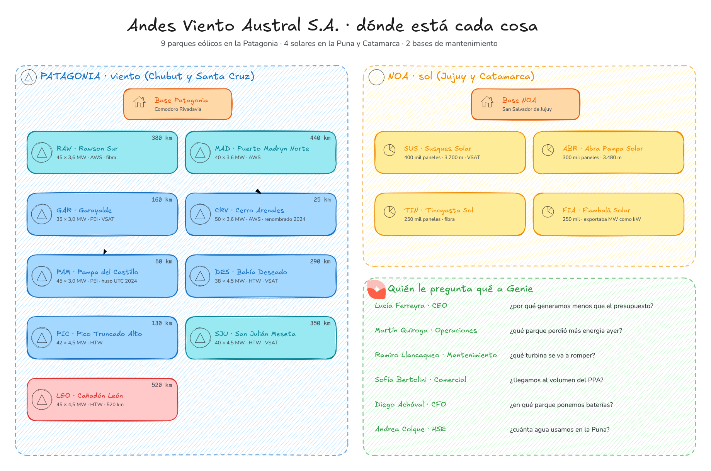
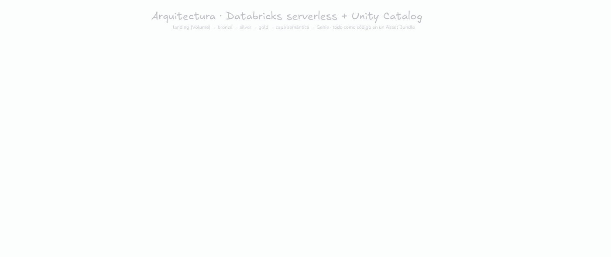
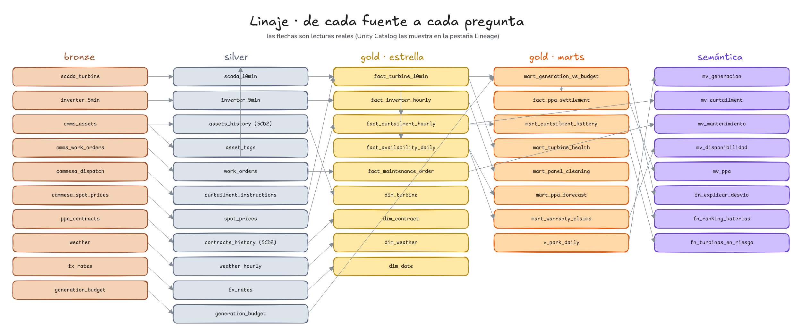
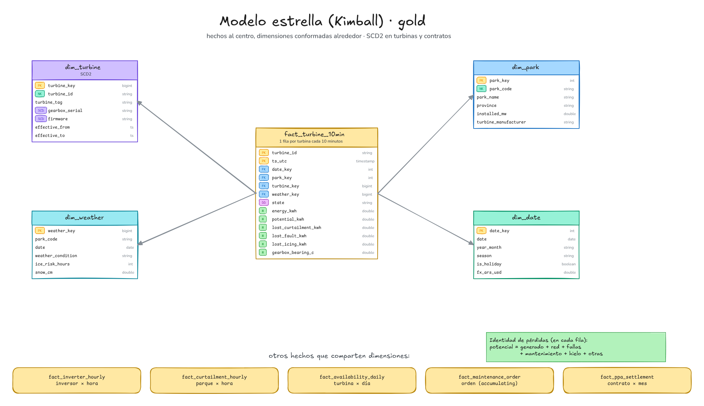
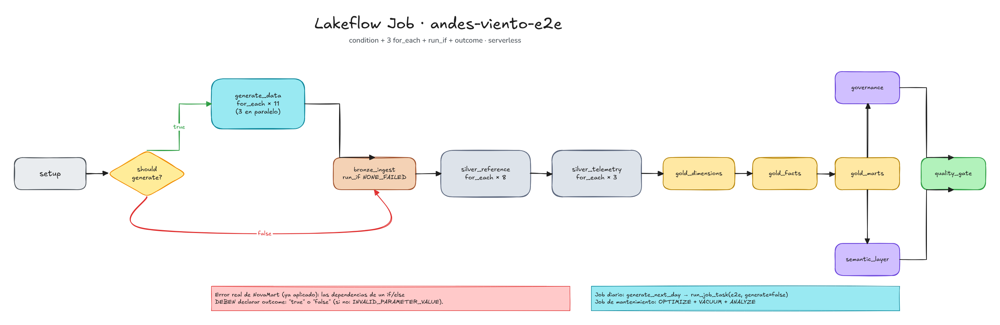
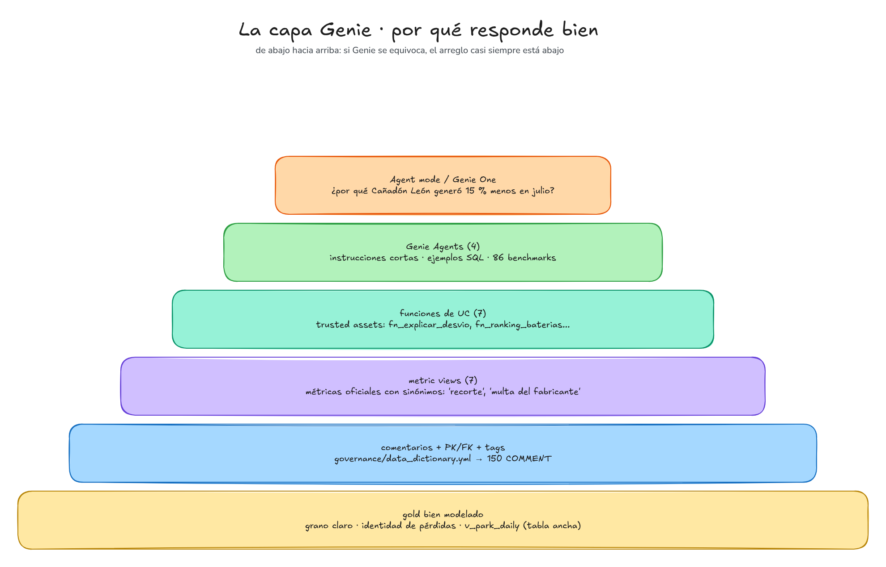
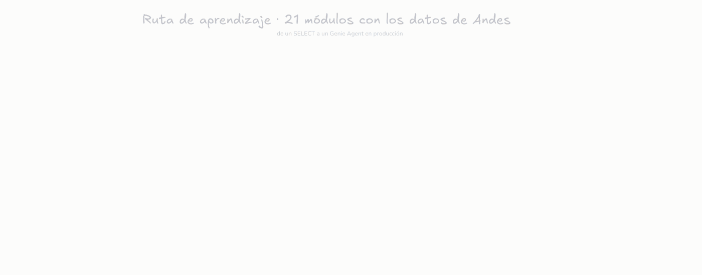

<p align="center">
  
</p>

<h1 align="center">🌬️☀️ Andes Viento Austral</h1>
<p align="center"><b>Un lakehouse de energía renovable en Databricks con Genie en el centro.</b><br/>
9 parques eólicos en la Patagonia · 4 solares en la Puna · las áreas de la empresa le preguntan a Genie.</p>

<p align="center">
  
  
  
  
  
  
  
  
  
</p>

> **No confundir con NovaMart.** [NovaMart](https://github.com/MauricioGarcia98/novamart-lakehouse) es el proyecto
> para entender la plataforma. **Andes** busca parecerse lo más posible a un negocio real (con historia, personas,
> inflación, CAMMESA, nieve y polvo) y usar Genie como lo usaría una empresa.

## 📑 Índice

- [La empresa en 30 segundos](#-la-empresa-en-30-segundos)
- [Qué le pregunta cada área a Genie](#-qué-le-pregunta-cada-área-a-genie)
- [El proceso completo](#-el-proceso-completo)
- [Resultados reales del deploy](#-resultados-reales-del-deploy)
- [Replicarlo desde cero](#-replicarlo-desde-cero)
- [Estructura del repo](#-estructura-del-repo)
- [Documentación](#-documentación)
- [Ruta de aprendizaje](#-ruta-de-aprendizaje)

## 🏭 La empresa en 30 segundos

**Andes Viento Austral S.A.** nació en 2009 en Comodoro Rivadavia. Hoy opera 380 aerogeneradores (≈1,5 GW) y
1,2 millones de paneles (≈660 MWp). Vende energía a CAMMESA y a 8 industrias por contratos PPA en el MATER.
Sus problemas son los de cualquier renovable argentina: la línea de 500 kV de la Patagonia está saturada
(**curtailment**), una multiplicadora rota en Santa Cruz en invierno son 3 semanas parada, el polvo de la Puna baja la
generación y el agua para limpiar es escasa, los contratos comprometen volúmenes planos con un viento que no es plano,
y la inflación y el dólar mueven todos los costos.

<details>
<summary><b>Ver los 13 parques</b></summary>

| parque | provincia | tecnología | equipos (SF=1) | fabricante |
|---|---|---|---|---|
| Rawson Sur · Puerto Madryn Norte · Cerro Arenales | Chubut | eólico | 45 · 40 · 50 × 3,6 MW | Aurora Wind Systems |
| Garayalde · Pampa del Castillo | Chubut | eólico | 35 · 45 × 3,0 MW | Pampa Eólica Industrial |
| Bahía Deseado · Pico Truncado Alto · San Julián Meseta · Cañadón León | Santa Cruz | eólico | 38 · 42 · 40 · 45 × 4,5 MW | Hanse Turbinen Werke |
| Susques · Abra Pampa | Jujuy (Puna, 3.500+ m) | solar | 400 mil · 300 mil paneles | — |
| Tinogasta · Fiambalá | Catamarca | solar | 250 mil · 250 mil paneles | — |

Historia, personas y clientes: [docs/01_la_empresa.md](docs/01_la_empresa.md).
</details>



## 🧞 Qué le pregunta cada área a Genie

| área | Genie Agent | pregunta típica | trusted asset |
|---|---|---|---|
| 🏗️ Operación (jefes de parque) | **Operación de parques** | ¿Por qué Cañadón León generó menos en julio 2025? | `fn_explicar_desvio` |
| 🔧 Mantenimiento | **Mantenimiento predictivo** | ¿Qué turbinas tienen riesgo alto de falla hoy? | `fn_turbinas_en_riesgo` |
| 🤝 Comercial | **Comercial PPA** | ¿Vamos a llegar al volumen comprometido este mes? | `fn_proyeccion_ppa` |
| 💵 Finanzas | **Finanzas y mercado** | ¿En qué parque conviene invertir en baterías? | `fn_ranking_baterias` |
| 🏢 Dirección | Agent mode / Genie One | ¿Por qué el trimestre quedó debajo del presupuesto? | cascada + varias consultas |

Los 5 casos de negocio (problema → quién lo sufre → decisión → KPI → datos → tablas → dashboard → preguntas):
[docs/03_casos_de_negocio.md](docs/03_casos_de_negocio.md).

## 🔄 El proceso completo

<p align="center"></p>

| capa | qué hace | dónde |
|---|---|---|
| **Generador** | 11 fuentes sintéticas distribuidas y determinísticas, con física de viento y sol y suciedad realista | `src/andes_viento/datagen/` |
| **Bronze** | Auto Loader: `schemaHints` en CSV y JSON, schema drift (HT-OS 5.0), reinicio ante `UNKNOWN_FIELD_EXCEPTION` | `ingestion/bronze.py` |
| **Silver** | relojes y husos (percentil de la demora), kW/MW, sensores clavados, CDC, SCD2, reglas + cuarentena | `silver/` |
| **Gold** | 7 dimensiones, 6 hechos con pérdidas por causa, 9 marts SQL por caso | `gold/`, `sql/marts/` |
| **Gobierno** | comments, PK/FK, tags PII, máscaras, row filter por parque (desde un YAML) | `governance/`, `sql/governance/` |
| **Semántica** | 7 metric views y 7 funciones de UC (trusted assets) | `sql/semantic/` |
| **Genie** | 4 agents versionados (`serialized_space`), 86 benchmarks, deploy por SDK, App con Conversation API | `genie/`, `scripts/`, `apps/` |
| **Orquestación** | job e2e (condition + 3 for_each + run_if), diario, mantenimiento, pipeline declarativo | `resources/`, `pipelines/` |
| **CI/CD** | ruff + pytest (Spark/Delta local) + bundle validate + deploy manual | `.github/workflows/ci.yml` |

<details>
<summary><b>Arquitectura, linaje y modelo (diagramas)</b></summary>







Todos los diagramas: [docs/diagrams/](docs/diagrams/README.md).
</details>

## ✅ Resultados reales del deploy

Corrido en un workspace **Databricks Free Edition**, `scale_factor = 0.1` (37 turbinas, 23 inversores, 2023-01 → 2026-09).
Detalle tarea por tarea y los errores que aparecieron: [docs/08_bitacora.md](docs/08_bitacora.md).

### Job e2e (dev, carga completa, run #3)

| tarea | estado | seg | | tarea | estado | seg |
|---|:-:|---:|---|---|:-:|---:|
| setup | ✅ | 36 | | gold_dimensions | ✅ | 63 |
| should_generate | ✅ | 1 | | gold_facts | ✅ | 74 |
| generate_data (11 fuentes) | ✅ | 654 | | gold_marts | ✅ | 57 |
| bronze_ingest | ✅ | 494 | | governance | ✅ | 207 |
| silver_reference (8) | ✅ | 822 | | semantic_layer | ✅ | 26 |
| silver_telemetry (3) | ✅ | 114 | | quality_gate | ✅ | 18 |

- **Prod** (`andes_viento`): 12/12 ✅. **Job diario** (día 2026-10-01): ✅ en ~12 min, `generate_data` EXCLUDED por la condición.
- **Pipeline LDP**: ✅ al primer intento, 3 min 14 s; expectations: 633 potencias y 2.166 temperaturas imposibles detectadas.
- **24 errores reales** encontrados y arreglados: 8 en la prueba local (L1-L8) y 16 en Databricks (R1-R16), cada uno
  con causa, arreglo y lección en la [bitácora](docs/08_bitacora.md).

### Lo que encuentran los datos (SF 0,1)

| pregunta | respuesta |
|---|---|
| ¿Por qué Cañadón León generó menos en julio 2025? | **−18,4 %**: curtailment por mantenimiento de la ET (−7,6 %), hielo (−5,0 %), menos viento (−4,0 %) |
| ¿HTW nos debe plata? | Disponibilidad 2025 **96,7 %** < garantía 97 % → ≈ **USD 659 mil** de *liquidated damages* |
| ¿Por qué el mantenimiento se multiplicó por 4 en USD? | Lote defectuoso de multiplicadoras: de 1 a 13 fallas mayores (USD 0,72 M → 3,09 M) |
| ¿Cumplimos con el data center? | 96,6 % en 2025, 3 meses con faltante, ≈ USD 225 mil |
| ¿Baterías en Santa Cruz? | **Hoy no**: 10.856 MWh recortados valen USD 146 mil a spot (15 USD/MWh con orden); repago ~78 años |
| ¿Por qué Susques genera menos en septiembre? | Suciedad de 11,1 % por tormentas de polvo |
| ¿El modelo predictivo anticipa fallas? | 21 de 26 fallas mayores con alerta; 12 con ≥ 7 días |

### Genie Agents (en Databricks → **Genie**)

`Andes · Operación de parques` · `Andes · Mantenimiento predictivo` · `Andes · Comercial PPA` · `Andes · Finanzas y mercado`
(los de dev llevan el sufijo `[dev]`). Se usan desde la plataforma, sobre las tablas gold, metric views y funciones.

**Evaluación final (86 benchmarks, `scripts/genie_eval.py`, dev): 85/86 = 98,8 %**

| agent | benchmarks | aciertos |
|---|---:|---:|
| Operación de parques | 22 | 21 |
| Mantenimiento predictivo | 22 | 22 |
| Comercial PPA | 21 | 21 |
| Finanzas y mercado | 21 | 21 |

El único ❌ es una respuesta correcta en otro formato (códigos de parque en vez de nombres): Genie no es determinístico.

Evolución real de la evaluación (`scripts/genie_eval.py`, mismas 86 preguntas): **0 %** (parámetro `DATE`, R11) →
**74 %** → **91 %** → **93 %** → **98,8 %** (instrucciones, metric views, funciones a prueba de LLM, ejemplos SQL y
qué función certificada va en cada agent: R11-R16).
Detalle por pregunta: [docs/genie/resultados_benchmarks.md](docs/genie/resultados_benchmarks.md).


## 🚀 Replicarlo desde cero

Hay dos caminos para desplegarlo (y un tercero para construirlo vos) y llegan al mismo lugar. Las tres guías explican cada paso: qué hace, por qué, cómo verificarlo y qué hacer
si falla.

| camino | para quién | guía |
|---|---|---|
| 🖱️ **Desde la web** | nunca usaste Databricks o no querés instalar nada | [docs/11_guia_desde_la_web.md](docs/11_guia_desde_la_web.md) |
| 🛠️ **Construirlo vos, desde un repo vacío** | querés dominar Databricks, GitHub y CI/CD escribiendo cada archivo (sin IA) | [construir/](construir/README.md): 25 capítulos + puntos de control `etapa-01`...`etapa-19` |
| ⌨️ **Por terminal** | querés correr los tests locales, desplegar a prod y configurar CI/CD | [docs/10_despliegue_y_cicd.md](docs/10_despliegue_y_cicd.md) |

El resumen por terminal (cada línea está explicada en la guía):

```bash
# 1) Cuenta gratis: https://www.databricks.com/learn/free-edition  ·  Databricks CLI instalada
git clone https://github.com/MauricioGarcia98/andes-viento-austral.git && cd andes-viento-austral
python3 -m venv .venv && source .venv/bin/activate && pip install -e ".[dev,genie]"
ruff check src tests scripts apps && pytest -q          # tests locales (opcional, ~10 min)

# 2) Conectar la CLI (perfil DEFAULT) y crear el catálogo (una vez, en el SQL Editor):
databricks auth login --host https://<tu-workspace>
#    CREATE CATALOG IF NOT EXISTS andes_viento_dev;

# 3) Desplegar y correr (~45 min)
databricks bundle validate -t dev && databricks bundle deploy -t dev
databricks bundle run andes_e2e -t dev

# 4) Genie (o, sin terminal, el notebook notebooks/12_deploy_genie)
python scripts/deploy_genie.py --target dev
python scripts/genie_ask.py --target dev --agent 01_operacion_parques "¿Por qué Cañadón León generó menos en julio 2025?"
```

> 📌 Si cambiás código, **volvé a hacer `bundle deploy` antes de correr el job** (el job usa lo desplegado). Y evitá
> `full_refresh`: en Free Edition las tablas borradas cuentan ~7 días en la cuota de 500.

¿Cómo se construyó, en qué orden y por qué? [docs/17_como_se_construyo.md](docs/17_como_se_construyo.md) ·
¿Cómo se probó? [docs/18_pruebas.md](docs/18_pruebas.md) · ¿Cómo se opera día a día? [docs/19_operacion_diaria.md](docs/19_operacion_diaria.md)

<details>
<summary><b>Correr todo en local (sin Databricks)</b></summary>

```bash
python -m venv .venv && . .venv/bin/activate
pip install -e ".[dev]"
ruff check src tests scripts apps
pytest -m "not integration"      # 27 tests unitarios (~2 min)
pytest -m integration            # pipeline completo landing -> gold + quality gate (5 semanas, SF 0,03)
python scripts/run_local.py --scale-factor 0.03 --start 2025-06-25 --end 2025-07-31
```
</details>

## 🗂️ Estructura del repo

<details>
<summary><b>Ver el árbol</b></summary>

```
├── databricks.yml                 # Asset Bundle: variables y targets dev / prod
├── resources/                     # jobs (e2e, diario, mantenimiento), pipeline LDP, dashboards, app, schema
├── src/andes_viento/
│   ├── datagen/                   # reference (empresa), physics, events (tablas guía), generators, writer
│   ├── ingestion/bronze.py        # Auto Loader
│   ├── silver/                    # transforms, rules, scd2, load
│   ├── gold/                      # dimensions, facts, marts (runner SQL)
│   ├── quality/                   # expectations (warn/quarantine/fail) + gate
│   └── genie/conversation.py      # cliente de la Conversation API
├── notebooks/                     # 13 notebooks delgados (%run ./_bootstrap + 1 llamada) + deploy de Genie
├── pipelines/                     # versión declarativa (LDP) en SQL
├── sql/marts | governance | semantic
├── governance/data_dictionary.yml # fuente única de comments, PK/FK y tags
├── genie/src/*.yml → genie/agents/*.json (serialized_space)
├── dashboards/*.lvdash.json       # 6 dashboards AI/BI
├── apps/genie_chat/               # Databricks App (Streamlit + Conversation API)
├── .assistant_instructions.md + .assistant/skills/   # Genie Code
├── scripts/                       # build_governance, build_dashboards, build_genie, deploy_genie, genie_ask, genie_eval
├── tests/                         # pytest + Spark/Delta local
├── learning/                      # 21 módulos
├── construir/                     # curso: construirlo desde un repo vacío (25 capítulos)
└── docs/                          # 20 documentos + ADRs + diagramas + animaciones
```
</details>

## 📚 Documentación

Empezá por [docs/00_empeza_aca.md](docs/00_empeza_aca.md): explica las palabras mínimas y qué leer según lo que quieras hacer.

| entender | hacer | profundizar |
|---|---|---|
| [00 · Empezá acá](docs/00_empeza_aca.md) | [10 · Replicar desde cero (terminal)](docs/10_despliegue_y_cicd.md) | [05 · Arquitectura + ADRs](docs/05_arquitectura.md) |
| [01 · La empresa](docs/01_la_empresa.md) | [11 · Guía desde la web](docs/11_guia_desde_la_web.md) | [06 · Fuentes y suciedad](docs/06_fuentes_y_suciedad.md) |
| [02 · Roles y decisiones](docs/02_roles_y_decisiones.md) | [12 · Genie](docs/12_genie.md) | [07 · Modelado dimensional](docs/07_modelado_dimensional.md) |
| [03 · Casos de negocio](docs/03_casos_de_negocio.md) | [19 · Operación diaria](docs/19_operacion_diaria.md) | [09 · Performance y escala](docs/09_performance_y_escala.md) |
| [17 · Cómo se construyó](docs/17_como_se_construyo.md) | [Agent mode: preguntas de "por qué"](docs/genie/agent_mode.md) | [04 · Diccionario de datos](docs/04_diccionario_de_datos.md) |
| [18 · Cómo se probó](docs/18_pruebas.md) | [16 · Autoevaluación](docs/16_autoevaluacion.md) | [08 · Bitácora de errores reales](docs/08_bitacora.md) |
| [15 · Glosario](docs/15_glosario.md) | [14 · FAQ](docs/14_faq.md) | [13 · Cómo hacerlo más real](docs/13_hacerlo_mas_real.md) |

## 🎓 Ruta de aprendizaje



21 módulos con los datos del proyecto, de un `SELECT` a un Genie Agent en producción: [learning/](learning/README.md).

---
<sub>Empresa, personas y clientes ficticios. Los datos macro (inflación, dólar) están inspirados en la Argentina 2023-2026 y redondeados. Licencia MIT.</sub>
