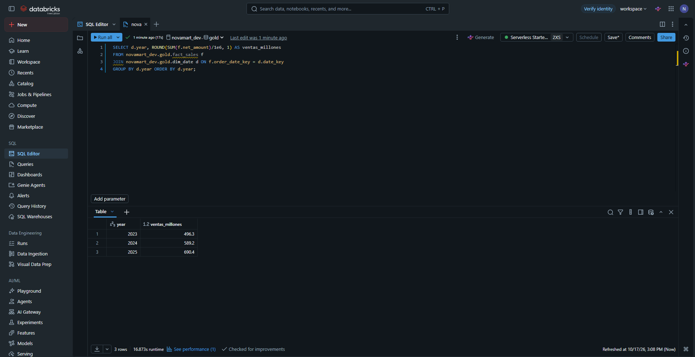
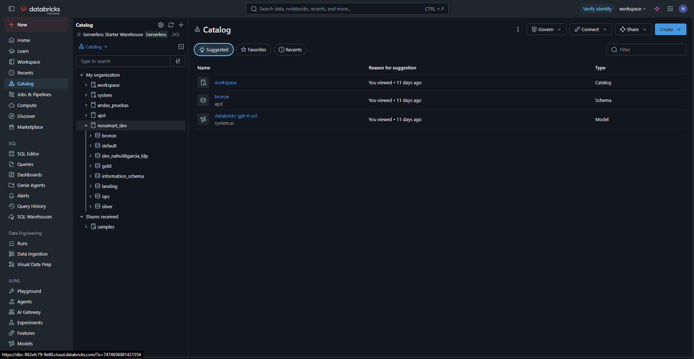
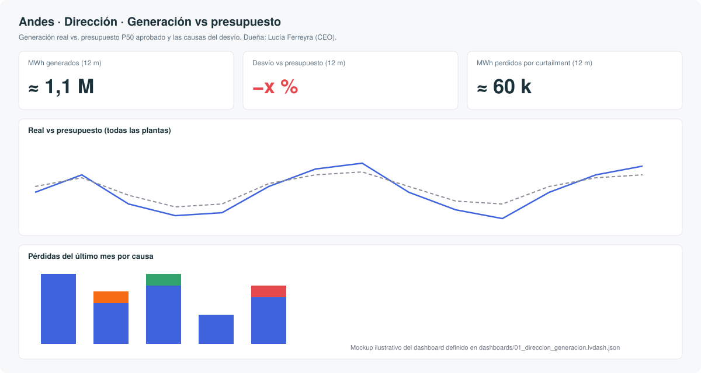
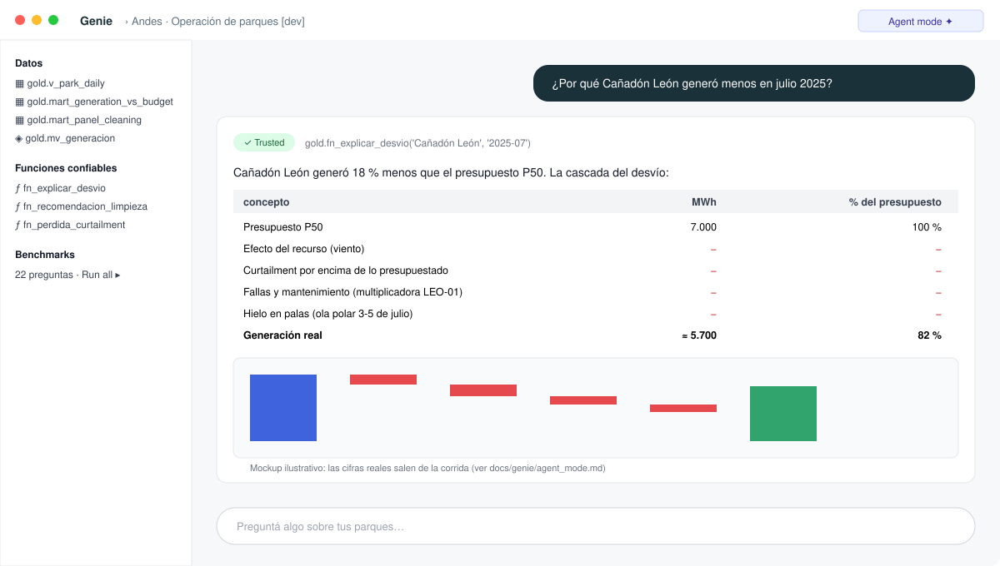

# 11 · Guía paso a paso desde la web (para alguien que nunca usó Databricks)

> Las pantallas de Databricks cambian seguido. Las imágenes de `img/ui/` son capturas del proyecto NovaMart (mismo
> workspace, mismos menús) y *mockups* de las pantallas nuevas. Si algo no coincide, buscá el nombre del menú.

## 1. Crear la cuenta (Free Edition)

1. Entrá a **databricks.com/learn/free-edition** → *Sign up*. Con un email alcanza.
2. Te crea un workspace con Unity Catalog, compute serverless y un SQL warehouse ("Serverless Starter Warehouse").


## 2. Traer el código

1. Menú izquierdo **Workspace** → tu carpeta de usuario → **Create → Git folder**.
2. URL: la de este repositorio en GitHub. Rama: `main`.
3. Vas a ver `src/`, `notebooks/`, `sql/`, `genie/`... igual que en GitHub.


## 3. Crear el catálogo (paso obligatorio en Free Edition)

1. Menú **SQL Editor** → arriba a la derecha elegí *Serverless Starter Warehouse*.
2. Pegá y corré:
   ```sql
   CREATE CATALOG IF NOT EXISTS andes_viento_dev COMMENT 'Andes Viento Austral (dev)';
   ```
3. Menú **Catalog**: tiene que aparecer `andes_viento_dev` (vacío por ahora).



> ¿Por qué a mano? Porque en Free Edition el catálogo usa *Default Storage* y la API que usan los bundles no puede
> crearlo (error real: `Metastore storage root URL does not exist`, ver [bitácora](08_bitacora.md)).

## 4. Desplegar el bundle desde la web

1. En el Git folder, abrí `databricks.yml`. Arriba aparece el panel **Deployments** (ícono de cohete).
2. Target **dev** → **Deploy**. Espera ~1 minuto.
3. Menú **Jobs & Pipelines**: aparecen `[dev tu_usuario] andes-viento-e2e`, `-daily`, `-maintenance` y `-ldp`.


## 5. Correr el job principal

1. **Jobs & Pipelines → andes-viento-e2e → Run now**.
2. Pestaña **Runs → Graph**: vas a ver el DAG pasar de gris (pending) → azul (running) → verde (succeeded),
   igual que el SVG animado del README. Las tareas `generate_data`, `silver_reference` y `silver_telemetry` son
   **for each**: hacé clic para ver cada iteración.
3. Tarda ~45-60 minutos a SF 0,1.


Si algo falla: clic en la tarea roja → lees el error → arreglás → **Repair run** (sólo corre lo que falló).

## 6. Mirar los datos

1. **Catalog → andes_viento_dev → gold**: abrí `mart_generation_vs_budget` → pestaña **Sample data**.
2. Pestaña **Lineage**: de qué tablas sale (bronze → silver → gold).
3. Abrí `learning/01_sql_select_filtros_orden.sql` y corré las celdas.




## 7. Dashboards

**Dashboards → Andes · Dirección · Generación vs presupuesto** (y los 5 de cada caso). Si piden warehouse, elegí el
*Serverless Starter Warehouse*. Publicalo para compartirlo.



## 8. Genie Agents

Opción A (recomendada): desde una terminal con la CLI configurada:
```bash
python scripts/deploy_genie.py --target dev
```
Opción B (a mano, para entender): **Genie → New** → agregá las tablas de `genie/src/01_operacion_parques.yml`
(`tables` + `metric_views`) → en **Instructions** pegá `instructions` → en **SQL Queries & Functions** agregá los
ejemplos y las funciones (`fn_explicar_desvio`, ...) → en **Benchmarks** cargá las preguntas.

Probá: *"¿Por qué Cañadón León generó menos en julio 2025?"*. Debería invocar `fn_explicar_desvio` y mostrar la
cascada (ver [respuesta esperada](genie/agent_mode.md)).



## 9. Agent mode (preguntas de "por qué")

En Genie, activá **Agent mode** (o usá Genie One desde la página de inicio) y pegá una de las preguntas de
[genie/agent_mode.md](genie/agent_mode.md). Mirá el plan que arma y las consultas que corre.

## 10. La App

**Compute → Apps → andes-genie-chat → Start**. Abrí la URL, elegí el agent y conversá.

## 11. Genie Code (el asistente que te ayuda a construir)

Abrí cualquier notebook → ícono del asistente (✨) → preguntá *"¿cómo agrego una fuente nueva a este proyecto?"*.
Si corriste `scripts/install_assistant_files.py`, va a responder con las convenciones de la skill
`andes-medallion-conventions`.

## Errores típicos y qué hacer

| ves esto | significa | hacé esto |
|---|---|---|
| `CATALOG_DOES_NOT_EXIST` | no hiciste el paso 3 | crear el catálogo por SQL |
| `There are already 5 active runs (limit: 5)` | tope de corridas simultáneas de Free Edition | esperar: queda en cola sola |
| `UNKNOWN_FIELD_EXCEPTION` en los logs de bronze | apareció una columna nueva | nada: el código reinicia el stream |
| un dashboard "sin datos" | el job todavía no terminó | esperar al `quality_gate` verde |
| Genie dice "no tengo acceso" | permisos sobre el catálogo | `GRANT USE CATALOG, USE SCHEMA, SELECT ...` |
